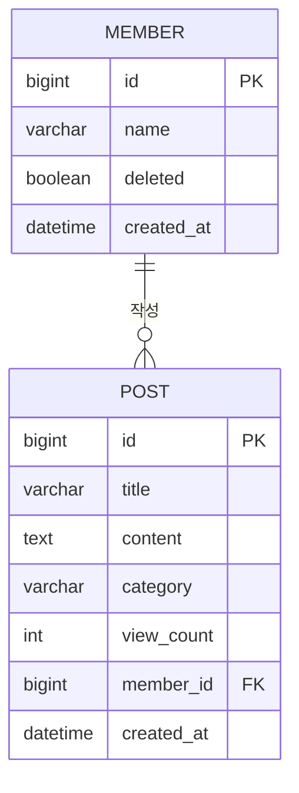

# ERD

3차 과제 요구사항(게시판은 게시글만 존재, 회원이 게시글을 작성, 조회 시 제목·본문·작성자·조회수 표시)을 기준으로 먼저 설계했습니다.

## 설계 결정

- **게시판 테이블은 두지 않습니다.** 요구사항에 "게시판은 게시글만 존재"한다고 했기 때문입니다.
- **회원과 게시글은 1:N입니다.** 외래키는 N쪽인 `post.member_id`에 두고 NOT NULL로 합니다. 모든 게시글은 작성자를 반드시 참조해야 하기 때문입니다.
- **회원 탈퇴는 행을 지우지 않고 `deleted`로 표시합니다(soft delete).** 게시글은 남기고 작성자를 "탈퇴한 회원"으로 보여줍니다. 탈퇴했다고 다른 사람이 읽던 글이 사라지면 곤란하고, 회원 행이 남아 있어야 `post.member_id`가 항상 유효한 참조가 됩니다.
- **`created_at`은 `BaseEntity`로 공통화합니다.** 회원과 게시글이 모두 가지는 필드입니다.
- **좋아요(`POST_LIKE`)는 심화 과제에서 추가합니다.** `(member_id, post_id)`에 유니크 제약을 걸 예정입니다.
