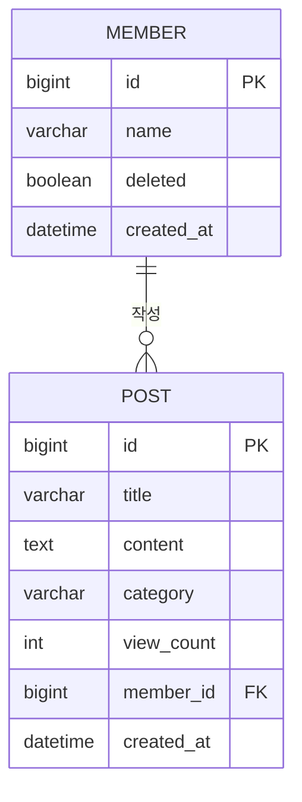
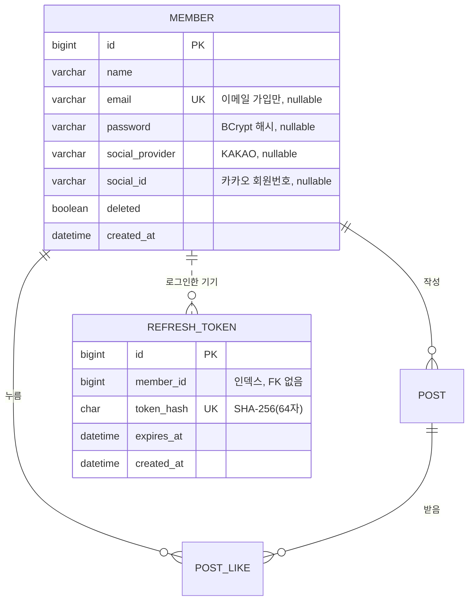

# ERD

3차 과제 요구사항(게시판은 게시글만 존재, 회원이 게시글을 작성, 조회 시 제목·본문·작성자·조회수 표시)을 기준으로 먼저 설계했습니다.

## 설계 결정

- **게시판 테이블은 두지 않습니다.** 요구사항에 "게시판은 게시글만 존재"한다고 했기 때문입니다.
- **회원과 게시글은 1:N입니다.** 외래키는 N쪽인 `post.member_id`에 두고 NOT NULL로 합니다. 모든 게시글은 작성자를 반드시 참조해야 하기 때문입니다.
- **회원 탈퇴는 행을 지우지 않고 `deleted`로 표시합니다(soft delete).** 게시글은 남기고 작성자를 "탈퇴한 회원"으로 보여줍니다. 탈퇴했다고 다른 사람이 읽던 글이 사라지면 곤란하고, 회원 행이 남아 있어야 `post.member_id`가 항상 유효한 참조가 됩니다.
- **`created_at`은 `BaseEntity`로 공통화합니다.** 회원과 게시글이 모두 가지는 필드입니다.
- **좋아요(`POST_LIKE`)는 심화 과제에서 추가합니다.** `(member_id, post_id)`에 유니크 제약을 걸 예정입니다.

## 6차 과제: 인증 추가

- **이메일 가입과 소셜 가입을 한 테이블에 둡니다.** 로그인 방식이 달라도 게시글, 좋아요가 같은 `member.id`를 참조해야 하기 때문입니다. 방식마다 쓰지 않는 컬럼은 비워 둡니다(`email`/`password` 또는 `social_provider`/`social_id`).
- **`email`, `(social_provider, social_id)`에 유니크 제약을 겁니다.** 동시에 같은 이메일로 가입하는 요청은 애플리케이션 검사만으로 막을 수 없습니다. MySQL 유니크 인덱스는 NULL을 중복으로 보지 않으므로 소셜 회원(이메일 NULL)이 여러 명이어도 괜찮습니다.
- **비밀번호는 BCrypt 해시만 저장합니다.** 솔트가 해시 문자열 안에 들어 있어 별도 컬럼이 없습니다.
- **Refresh Token은 원문이 아닌 SHA-256 해시만 저장합니다.** DB가 유출돼도 저장된 값으로 재발급을 받을 수 없습니다. 한 회원이 여러 기기에서 로그인할 수 있도록 회원당 여러 행을 허용합니다.
- **`refresh_token.member_id`에는 외래키를 걸지 않습니다.** 토큰은 로그인할 때마다 생기고 지워져 회원과 생명주기가 다르고, 회원은 soft delete라 참조가 끊길 일이 없습니다. 조회를 위해 인덱스만 둡니다.
